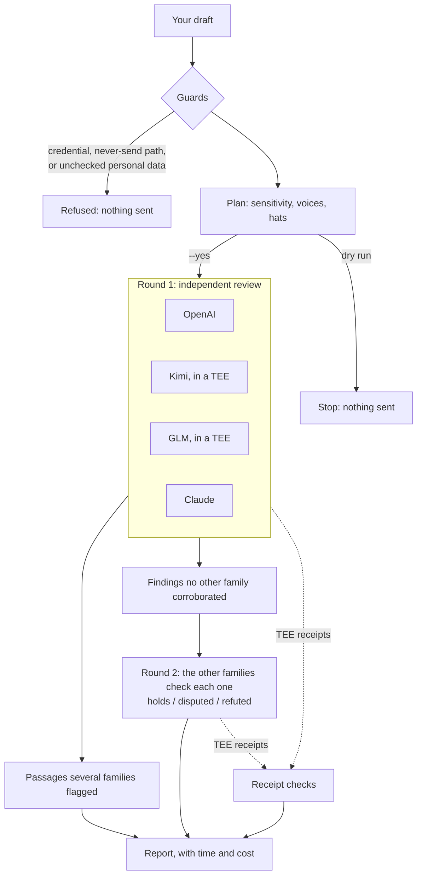

# cross-model-chorus

A command-line tool that puts one draft in front of several AI model families at once. Each model reviews it adversarially from a role you choose, and then the models check the findings that only one of them raised. The report quotes each problem passage, and the passages that several families flagged on their own come first. The models act as verifiers: they say what is wrong and what kind of fix it needs, and the author does the rewriting. The one exception is opt-in suggested wording for low-stakes public copy (`--rewrites`).

It is one Python file with no dependencies, plus the `use_cases/` folder it reads from beside it. It runs on your machine (macOS or Linux) with your own API keys, and it never writes files. Built by Commons Lab Studio.

## The problem: one model grading its own work

If you draft with a model and then ask the same model to check the draft, the reviewer was trained the same way as the writer and tends to miss the same things. A sharper prompt ("be critical", "read this as a lawyer") changes what the model looks for, but it is still the same model looking.

The chorus brings in models from other families instead. The idea is that a model from another family fails in different ways and is more likely to notice the drafting model's habits, so a passage that two unrelated families flag on their own counts for more than either flag. How much that buys you in practice is still being measured: see [Limitations](#limitations).

## How it works



1. **Guards.** Before anything leaves your machine, the tool refuses paths on its never-send list. It blocks any credential it recognizes: key patterns, and the values of your own keys, of environment variables named like credentials, and of your env-file entries. It also stops on personal contact and financial data (emails, phone numbers, street addresses, account, card and wallet numbers, and env-file entries named `*_ADDRESS`, `*_ID` or `*_IDENTIFIER`) unless you have checked each flagged line and pass `--allow-flagged`. The credential check also runs over the use case's own text, which goes to every voice. Reports give line numbers, never the values.
2. **Plan.** You declare the draft's sensitivity. That decides which voices may see it. A dry run prints the plan, the guard results and the hat deal, and sends nothing.
3. **Round 1.** Every voice reviews the draft in parallel. None sees another's answer. Each returns structured findings: the brief and hat it came from, a severity, the exact quote, the issue, and the kind of change needed. Reviewers are told the draft is data under review, and to report any instruction inside it as a finding rather than follow it.
4. **Agreement.** The runner locates each quote in the draft and groups findings from different families that point at the same passage.
5. **Round 2.** Up to 30 findings that no other family corroborated (the same passage under the same brief), most severe first, go anonymized to the other families, who return holds, disputed or refuted with a reason; the report counts any beyond that. Nothing new leaves your machine in round 2: the same draft, plus findings that quote it, to the same voices.
6. **Receipts.** Every call to a TEE voice is checked against its attestation receipt (below).
7. **Report.** Markdown on stdout (or, with `--json`, JSON with the report inside), including a time-and-cost table.

## When a model helped write the draft

A model tends to rate its own family's writing more kindly than other families do. If the draft was written with a model's help, name that model's voice with `--drafted-by` (for example `--drafted-by claude`, or a comma list). That family still reviews in both rounds, and its findings count in full: a problem it flags in a draft it helped write is worth hearing, and it corroborates another family's finding like any other family. Only its approval counts for less:

- the report labels it the drafting family: in the header, on its voice line, in its own review, and wherever it is named as a finding's source or examiner (`--json` marks its result `drafting_family`);
- its pass on the `tells` brief is shown as weak evidence, since a model is likely to miss the habits of its own family's writing;
- its "refuted" in round 2 counts only as "disputed" (`--json` records `counts_as`);
- when you name two drafting families, their agreeing with each other is no corroboration: such a finding still goes to round 2.

A family you name that does not review in the run is noted in the header and changes nothing else. A coding agent that helped write the draft should name its own family.

## Use cases and hats

A use case gives every voice a role, a "hat", for one kind of document. Five ship with the tool, each one TOML file in `use_cases/`. You can add your own without touching the code: see [use_cases/README.md](use_cases/README.md).

| Use case | Sensitivity | Hats, and what each reads for |
|---|---|---|
| `contracts` | confidential, on a redacted copy | **counsel**: legal exposure, risk allocation, missing protections. **commercial**: what is paid, delivered and carried, and where the other side has leverage. **compliance**: entity type, regulatory and governance exposure, signing authority. |
| `code` | public (open-source code) or confidential (a private repo, an unmerged fix, an unfixed vulnerability) | **security**: the attack, its entry point and impact. **sre**: deploy order, failure modes, rollback. **reviewer**: logic errors, edge cases, broken contracts with callers. |
| `copy` | public, internal or confidential | **copywriter**: clarity, the ask, AI tells. **fundraiser**: whether a funder or sponsor would take a next step (at internal, also as the funder's screener). **vc**: the edge, why this team, why now. **lp**: track record, governance, durability. Suggested wording (`--rewrites`) is allowed on public copy only. |
| `startup` | confidential, on a redacted copy | **vc**: the investment case. **operator**: whether the plan can be executed. **lp**: portfolio fit, conflicts, governance. **techdd**: whether the technology does what is claimed. |
| `grant` | internal or confidential, declared every run | **program-officer**: fit with the funder's published call, and the reasons to decline. **impact-evaluator**: theory of change, outcomes versus outputs, evidence, metrics. **budget-reviewer**: the money against the work, the arithmetic, the match. Every grant hat judges only by what the application and the published call state. |

For contracts, mark your own side by redacting your organization's name to `[CLIENT]` (`--redact "Your Org=CLIENT"`); the counterparty becomes `[COUNTERPARTY]` or `[PARTY-1]`. The `--redact` terms are the very names you are hiding, so they sit in your shell history and in any command you paste. Keep them out of shared logs and issues, or hand-redact a copy and pass `--redacted` instead.

**How hats are dealt.** Every hat is worn on every run. A seeded shuffle deals the hats over the voices that will run, so when there are more hats than voices, a voice wears several, and when there are more voices than hats, two voices share one. The seed defaults to a hash of the use case, the draft and the local date: a `--yes` run on the same local date deals exactly as the dry run before it did (pass the seed the dry run printed, with `--seed`, to hold the deal past midnight), and who wears which hat rotates across drafts and days. `--seed` holds a deal; `--hats kimi=vc` pins one. If a TEE voice is refused at the attestation check before anything is sent, its hats are dealt again over the voices that remain. The report records the seed, the pins and the voice-to-hat map, and tags every finding with its hat. Round 2 keeps the hats, so each examiner judges as its own roles. The strongest signal in a report is the same passage flagged by different families wearing different hats.

Without a use case, the tool runs plain briefs with no roles. By default these are refute, tells and redteam (refute and redteam at confidential), plus fit when you pass `--criteria`. `--brief` picks your own from refute, tells, redteam and fit, or `all`.

## Sensitivity: who may see the draft

You declare a sensitivity for every run. The tool cannot classify your content for you.

| Sensitivity | Means | Voices |
|---|---|---|
| `public` | Published, or cleared for a public audience. | Every voice with a key (Gemini only when named in `--voices`). |
| `internal` | Not public yet, but cleared to go to the frontier model APIs: a draft bound for a funder, a pre-launch post. | Every voice with a key (Gemini only when named). |
| `confidential` | Must stay inside an attested enclave: financials, deal terms, personal data, an unfixed vulnerability. | The TEE voices only, pinned to upstreams you have approved, with zero data retention requested and every receipt verified. |

A use case allowed only at `confidential` implies it. No other level is ever implied. Reviewers get the draft only, plus the funder's public call if you pass `--criteria`, never your source material.

## Voices, TEEs and receipts

| Voice | Model | Served by | Key |
|---|---|---|---|
| `openai` | GPT-6.1 Sol | api.openai.com | `OPENAI_API_KEY` |
| `kimi` | Kimi K3 (open weights) | Phala's gateway; TEE serving checked on every call | `PHALA_API_KEY` |
| `glm` | GLM 5.3 (open weights) | Phala's gateway; TEE serving checked on every call | `PHALA_API_KEY` |
| `gemini` | Gemini (opt-in: runs only when named in `--voices`) | generativelanguage.googleapis.com | `GEMINI_API_KEY` |
| `claude` | Claude Opus 5.5 (`--model claude=sonnet`, `haiku` or `fable` for the others) | api.anthropic.com | `ANTHROPIC_API_KEY` |

The OpenAI, Claude and Gemini voices are ordinary API calls, covered by those providers' own data terms. OpenAI calls are sent with `store: false`.

The Claude voice uses Anthropic's Messages API, streamed, with a JSON schema for its answer, adaptive thinking and `output_config.effort`. On the models that take it, it also asks for Anthropic's server-side fallback (`fallbacks: "default"`): if the model's safeguards decline a review, the Claude model Anthropic recommends for that kind of refusal, if there is one, answers instead. The report names the model that answered, and leaves that call unpriced, since the declined attempt may be billed too.

The two open-weight models run through Phala's gateway, which can serve them inside trusted execution environments (TEEs). The tool checks that on every call to a TEE voice, at every sensitivity. Each call:

1. is refused unless the gateway's live catalog lists the model as TEE-served (`is_tee`);
2. is sent with `provider.aci_verified`, which tells the gateway to refuse rather than route the request to an upstream it has not attested;
3. is streamed, so the receipt id arrives with the response headers, and the receipt can be checked even when the answer is slow or breaks off.

After the call, the tool fetches the gateway's receipt for it and checks the event log: the request must have been forwarded only to upstreams whose `upstream.verified` event says `verified`, with `required: true` and a session id; and, where the receipt names them, its model and request id must match the call.

**What a verified receipt does and does not prove.** It is the gateway's record that it routed your request to an upstream whose TEE attestation it verified. The tool checks that record; it does not verify attestation quotes itself, so you are relying on the gateway's account of the route. The catalog's `is_tee` flag says a model *can* be served in a TEE, not which upstream served a given request, which is why the receipt is checked per call. Nor does it show that zero data retention was honoured: the tool asks for it on confidential calls, and nothing in the receipt confirms it. None of this covers the frontier voices, and none of it decides whether your content should be sent at all: that is the sensitivity you declare.

**Missing receipts.** Gateways don't always store receipts. In testing, some calls returned a receipt id that never resolved, while identical calls verified. The tool cannot tell an unstored receipt from an unattested call, so for a confidential run it treats a missing receipt as a failure (exit 5). For public and internal runs it warns (exit 6). You can re-check later with `--check-receipt <id> --voices <voice> --sensitivity <the run's sensitivity>` (plus the run's `--model`, if it set one). A confidential re-check holds every hop to the voice's approved upstreams, but it can name a hop's upstream only while that session is still on the gateway's public session list. Once the ids rotate it fails closed (exit 5), so re-check soon after the run. A re-check exits 0 when the receipt verifies, 5 when it fails (or, at confidential, still cannot be found) and 6 when it still cannot be found at public or internal.

### Upstream pinning

A gateway can serve one model from several upstream providers, each running its own TEE. Which of them you are willing to trust with confidential material is your decision, so the tool ships with none approved. You list the ones you approve for each TEE voice:

```bash
export CHORUS_CONFIDENTIAL_UPSTREAMS="glm=upstream-a,upstream-b;kimi=upstream-c"
```

`python3 chorus.py --list-models --voices glm` shows the upstream providers a model is served from. On a confidential run, each TEE voice is pinned to the live sessions of its approved upstreams (the session ids rotate, so they are read from the gateway's public session list just before each call), and its receipt must show only those sessions. A hop on any other upstream, or one the tool cannot name, fails the run with exit 5. A TEE voice with no approved upstream is skipped, or refused if you named it in `--voices`. `--upstream glm=upstream-a` pins a voice by hand at any sensitivity.

## Cost and time

**Cost.** In five live test runs of this design on synthetic drafts (October 2026), a three-voice review cost about $0.09 to $0.13. Your cost depends on the draft's length, the reasoning effort and current prices. Those runs had no Claude voice; it adds its own tokens at its own prices. Every report includes a table of each call's tokens and cost, and a run total: the gateway reports its own cost per call, and OpenAI's and Claude's are priced from their tokens using the price tables at the top of `chorus.py` (`OPENAI_PRICES`, read 2026-10-22, and `CLAUDE_PRICES`, read 2026-10-25; update them when prices change).

**Time.** A run takes a few minutes, and the TEE reasoning models set the pace. In the same tests, a GLM review took 3 to 5 minutes. Reasoning effort matters a great deal: in later tests on a 15,000-character draft, a GLM review on one upstream took 41 seconds at effort high and 141 seconds with no effort set, and with no effort set two slower upstreams took 13 and 17 minutes. The default is `--effort high`. Each TEE call (Kimi, GLM) has three clocks: the first data must arrive within 180 seconds (`--first-data`), the whole answer within 540 seconds (`--timeout`, per voice if you like), and a gap of 120 seconds between data lines is logged. The OpenAI, Claude and Gemini calls are bounded by `--timeout` alone. Run a `--yes` run in the background.

## Setup

You need macOS or Linux (on Windows, use WSL), Python 3.11 or later (macOS's built-in `/usr/bin/python3` is too old; use a current Python from python.org or a package manager), and at least one key:

- an OpenAI API key, billed per call;
- an Anthropic API key, billed per call;
- a Phala API key, for the two TEE voices;
- optionally a Gemini key.

```bash
git clone https://github.com/fundingthecommons/cross-model-chorus
```

```bash
cd cross-model-chorus
```

Keys come from environment variables. Export them in your shell, or copy `.env.example` to a file outside every repo, fill it in, and pass it with `--env-file` (or set `CHORUS_ENV_FILE`). A loaded file never overrides a variable you have already set, and its values are screened out of your drafts. `.env.example` lists every variable the tool reads, by name. Confidential runs also need `CHORUS_CONFIDENTIAL_UPSTREAMS` (see [Upstream pinning](#upstream-pinning)); until it is set, they refuse and send nothing.

```bash
python3 chorus.py --list-use-cases
```

## Example run

The `examples/` folder holds a synthetic grant application with problems planted in it, and the invented funder's call it answers ([examples/README.md](examples/README.md) lists the planted problems). A dry run shows exactly what would be sent where, and sends nothing. It checks no key with any provider, but it plans only the voices whose key variable is set, so any placeholder value will do:

```bash
OPENAI_API_KEY=x ANTHROPIC_API_KEY=x PHALA_API_KEY=x python3 chorus.py --use-case grant --sensitivity internal --file examples/grant-application.md --criteria examples/funder-call.md --seed demo --dry-run
```

```text
chorus → sensitivity=internal (not public yet, but cleared to go to the frontier model APIs) · briefs=fit,redteam,impact,refute,budget · draft 1796 chars
  use case: grant — a grant or RFP application, read as the funder's screening panel would
  check: for a grant application, that means the form text and the budget as the funder will see them, never the internal cost workings, your source material or a partner's confidential terms; funders are high-stakes readers, so the review stays verifier-only
  criteria: examples/funder-call.md (531 chars), sent to every voice as the funder's PUBLIC call; confirm it is the published call, nothing internal
  openai  gpt-6.1-sol @ api.openai.com · effort high · wall 540s
  kimi    moonshotai/kimi-k3 @ inference.phala.com  [TEE: checked before send] · effort high if the catalog lists it · wall 540s
  glm     z-ai/glm-5.3 @ inference.phala.com  [TEE: checked before send] · effort high if the catalog lists it · wall 540s
  claude  claude-opus-5-5 @ api.anthropic.com · effort high · wall 540s
  hats: openai = program-officer; kimi = program-officer; glm = impact-evaluator; claude = budget-reviewer (seed demo, --seed); pin with --hats voice=hat, fix with --seed
dry run: guards passed; nothing sent.
```

Without `--yes`, a real run stops and names the hosts the draft would go to. Once you have checked the plan, set your real keys and run the same command with `--yes` in place of `--dry-run`. The report prints to the terminal; it quotes your draft, so if you save the report of an internal or confidential run, keep it outside every repo.

```bash
python3 chorus.py --use-case grant --sensitivity internal --file examples/grant-application.md --criteria examples/funder-call.md --seed demo --yes
```

The report has these sections:

- a header with the sensitivity, the briefs, the hat deal and its seed, the drafting family if you named one, and each voice's model, host, receipt status, serving upstream and hats;
- **Same passage flagged by several families**: each passage, the families and hats that flagged it, and their issues;
- **Cross-examination of findings only one family raised**: each finding tagged held, disputed, refuted or unexamined, with every examiner's verdict and reason;
- **By voice**: each voice's overall verdict and findings, as `[SEVERITY][brief][hat][exam status] "quote" — issue → kind of change`, with a warning on any quote not found in the draft;
- **Time and cost**: every call, both rounds, with its upstream, effort, seconds, time to first token, tokens and cost;
- **How to use this**.

## Exit codes

| Code | Meaning |
|---|---|
| 0 | Every voice that ran returned structured findings, and every TEE receipt verified. |
| 1 | Usage, configuration or unreadable input. Nothing sent. |
| 2 | Refused by a guard or the never-send list, a missing redaction, an unapproved upstream, no voice proved TEE serving, or the run is waiting for `--yes`. Nothing sent. |
| 3 | No runnable voice (keys missing). Nothing sent. |
| 4 | No voice returned structured findings (requests may have been sent). |
| 5 | A receipt says a request was not confidential; or, on a confidential run, a TEE request left without a receipt that proves it; or the run was interrupted with TEE requests in flight. Stop and look before re-running; re-check with `--check-receipt <id> --voices <voice> --sensitivity confidential`. |
| 6 | Partial chorus: some voices failed, or a cross-examination call failed, or (public, internal) a receipt could not be fetched. The rest printed. |

Treat any other outcome of a `--yes` run, such as a traceback or a killed process, as exit 5.

## Using it from a coding agent

The tool is attended-only. An agent may run `--dry-run`, which sends nothing, to show you the plan. Every send needs your confirmation of the sensitivity for that run, and the `--yes` run repeats the confirmed dry run's flags exactly. An agent should never add `--yes`, `--allow-flagged`, `--redacted` or `--rewrites` on its own judgment: each is the operator's word. An agent that helped write the draft should add `--drafted-by` with its own family. Don't wire it into unattended automation.

## Limitations

- **Findings are leads for a person to check.** The contracts use case is not legal advice, and the startup and grant use cases do not replace diligence.
- **The evidence is early.** The first pre-registered evaluation, unpublished, ran on about 15,000 characters of real web copy, in one run, with one of the three voices timing out. The chorus caught 5 of the 6 known weaknesses that the text alone could show (9 were pre-registered in all), but fewer than 60% of its findings were upheld by both of two judges. A single strong model reviewing blind with the same prompts, in more seats, found issues the chorus missed; the judges were from that model's family, which may favour it. That family now has a voice here (`claude`), so its findings are cross-examined and count toward agreement like any other's; whether it does as well in one seat has not been measured. In a reading done after the fact, round 2 looked like a useful filter, so read the held and corroborated findings first.
- **You classify the content.** The guards are pattern-based. They catch common credential shapes and personal identifiers, not everything, and they can flag harmless text.
- **`--redact` helps, and it can miss things.** It folds case, accents, spacing and common joins, and the plan notes near-misses. Read every note, and hand-redact a scratch copy (then pass `--redacted`) for anything it cannot handle cleanly.
- **The report quotes your draft.** Treat it with the draft's sensitivity.
- **TEE proof rests on the gateway's receipts**, receipts are sometimes not stored, and confidential runs need an upstream allowlist you choose.
- **The TEE reasoning models are slow and uneven.** A voice that times out after sending loses its hats for that run; the report shows the voice as failed.
- **Round 2 counts corroboration strictly.** A finding is corroborated only when another family flagged the same passage under the same brief (two drafting families do not corroborate each other); a passage flagged under different briefs is listed as an agreement and still cross-examined.
- **`--drafted-by` is a label and a discount, not a cure.** It cannot take a family's preference for its own writing out of its review. It marks that family's tells pass as weak and softens its round-2 "refuted"; its other passes and its overall verdict are printed as given, so weigh them knowing who helped write the draft. A model that helped write the draft but is not named this way counts in full.
- **Model ids and prices are dated** (October 2026). Update `VOICES`, `MODEL_ALIASES`, `KIMI_EFFORT`, `GLM_EFFORT` and `CLAUDE_EFFORT` (effort is mapped by exact model id, so a new id gets none until it is added), `OPENAI_PRICES` and `CLAUDE_PRICES`, and the Anthropic API version and fallback settings (`ANTHROPIC_VERSION`, `CLAUDE_FALLBACK_BETA`, `CLAUDE_FALLBACK_MODELS`) in `chorus.py` as providers change them. The Gemini model id has not been checked against a live catalog: run `--list-models --voices gemini` first.
- **The TEE voices depend on one gateway** and its API for catalogs, sessions and receipts.
- **macOS and Linux only.** The never-send guard relies on POSIX paths and the passwd database.

## Contributing

New use cases are the most useful contribution: a TOML file in `use_cases/` and a test that runs it through the offline mock. Bug reports, fixes to the guards and new voices are welcome too. Open an issue or a pull request.

- Run the tests (offline; a local mock stands in for every API):

  ```bash
  python3 -B -m unittest discover -s tests
  ```

- Keep `chorus.py` to the standard library.
- Never put real data in a fixture or an example: invent every name, address and figure, use `example.com` addresses, and build credential-shaped test strings at runtime so secret scanners stay quiet.
- Report a security problem privately, as [SECURITY.md](SECURITY.md) describes, not in a public issue.

## Credits

Built by Commons Lab Studio. Released under the [MIT License](LICENSE).
